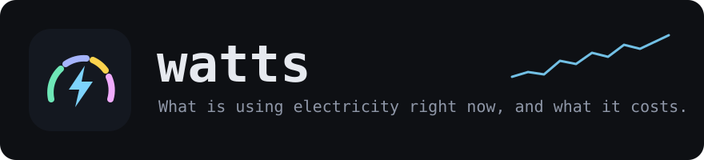
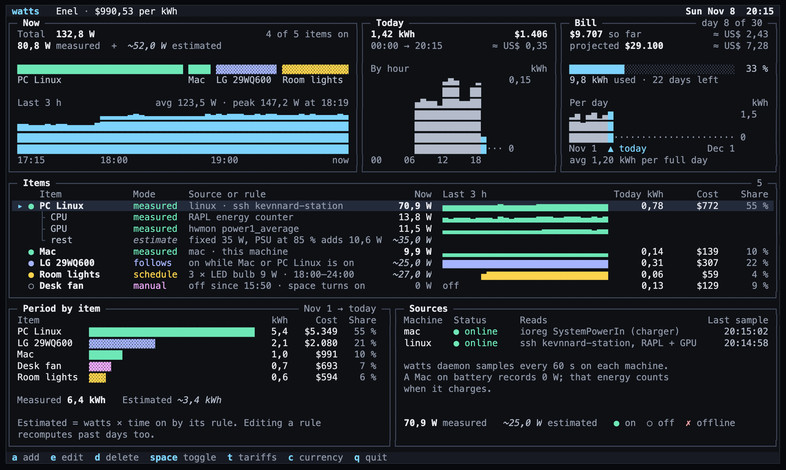
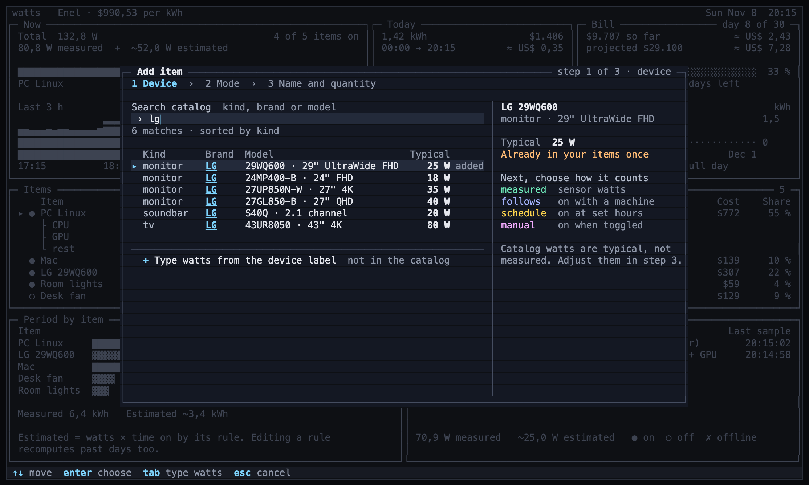
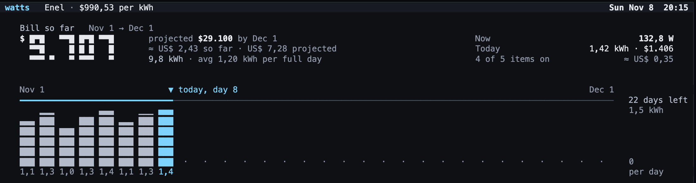
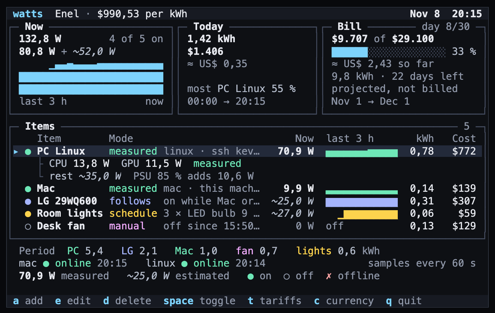

<p align="center">
  
</p>

<p align="center">
  A terminal dashboard for your desk and your room: live watts per device,<br>
  energy and cost for today, and how this month's electricity bill is going.
</p>

<p align="center">
  <a href="LICENSE.md"></a>
  
  
</p>

<p align="center">
  
</p>

> [!NOTE]
> The pictures in this README come from the approved design. They will be replaced with screenshots of the app when version 0.1.0 is released.

## What it answers

| | Question | Where you see it |
|:-:|:--|:--|
| ⚡ | **What is drawing power right now?** | The **Now** panel and the watts column, per device |
| 📅 | **How much did I use today?** | The **Today** panel: kWh, cost, and use by hour |
| 🧾 | **How is my bill going?** | The **Bill** panel and the bill view (`b`): so far, projected, and days left |

Real sensors are used where they exist: the Mac's charger input, and the Linux PC's CPU and GPU. Everything else, such as monitors, bulbs and fans, is estimated from its watts and the rule you give it. Estimated numbers always carry a `~`, so you can tell them apart from measured ones.

## Install

```bash
brew install kevnnard/tap/watts
```

<details>
<summary>Build from source</summary>

You need Go 1.27 or newer.

```bash
git clone https://github.com/kevnnard/watts
cd watts
go build -o ~/.local/bin/watts ./cmd/watts
```

On a Linux PC that you read from your Mac, put the binary in `~/.local/bin/watts`.
</details>

## Quick start

```bash
watts install   # 1. start recording in the background (once per machine)
watts           # 2. open the dashboard
```

3. Press **`a`** to add your devices, and **`t`** to type the price per kWh from your electricity bill.

That's it. `watts` writes down a reading every minute, so today's and this month's totals grow on their own, even while the dashboard is closed.

## Adding a device

Press **`a`**, type a brand or a model, and pick it from the built-in catalog. If your device isn't in the catalog, choose **Type watts from the device label** and type the number printed on its label or charger.

<p align="center">
  
</p>

Then choose how the device counts:

| | Mode | Counts while… | Example |
|:-:|:--|:--|:--|
|  | **measured** | a real sensor reports watts | your Mac, your Linux PC |
|  | **follows** | the machines you pick are on | a monitor that follows the Mac and the PC |
|  | **schedule** | the clock is inside your hours | room lights, `18:00-24:00` |
|  | **manual** | you switch it on with `space` | a desk fan |

Catalog watts are typical values, not measurements. If you change a device's watts or its rule, past days are recalculated too.

## Your bill

Press **`b`** for the bill view: what you have spent so far this period, what the full bill will be if you keep the same pace, and one bar per day.

<p align="center">
  
</p>

- **Tariffs (`t`).** Type the provider, the price per kWh and the day your bill starts, as printed on your bill. Add a new tariff whenever the price changes. Each past period keeps its own price.
- **Currency (`c`).** Pick your main currency (COP by default). You can also add a second currency, at an exchange rate you type in, and it is shown in dim text next to every amount.

## Keys

| Key | Action | Key | Action |
|:--|:--|:--|:--|
| `a` | add a device | `t` | tariffs |
| `e` | edit the selected device | `c` | currency |
| `d` | delete the selected device | `b` | bill view |
| `space` | switch a manual device on or off | `↑` `↓` / `j` `k` | move |
| `esc` | close a window | `q` | quit |

## Commands

| Command | What it does |
|:--|:--|
| `watts` | Opens the dashboard. |
| `watts status` | Prints a short text summary, handy in scripts or a status bar. |
| `watts install [--dry-run] [--binary PATH]` | Starts the background recorder: a LaunchAgent on macOS, a systemd user service on Linux. `--dry-run` shows what it would do and changes nothing. `--binary` picks the binary the recorder runs (default: this one, by its stable path, so a Homebrew install survives `brew upgrade`). |
| `watts daemon` | The recorder itself. `watts install` runs it for you. |
| `watts sensors [--json]` | Shows one reading of this machine's sensor. |
| `watts scan` | Lists the devices it finds on your local networks. It only reads: nothing is saved or added. |
| `watts export --json [--from TIME] [--to TIME]` | Prints stored readings as JSON. The Mac uses this to read the Linux PC. |
| `watts import-consumo [--dir DIR]` | Imports the daily files of the old `consumo` scripts. The files are only read, never changed. |
| `watts version` | Prints the version. |

Run `watts help <command>` for each command's flags.

<details>
<summary><b>Narrow terminals</b></summary>

At 80×24 the panels shrink to the key numbers and the table keeps watts, trend and today's cost.

<p align="center"></p>
</details>

<details>
<summary><b>Two machines: a Mac and a Linux PC</b></summary>

Run `watts install` on both machines. The dashboard on the Mac reads the Linux PC over SSH, so `ssh <host>` must work without a password prompt. The host name is in the config (`remote.host`, default `kevnnard-station`), and so is the path of `watts` on the PC (`remote.command`, default `~/.local/bin/watts`).

If the PC is off or can't be reached, it shows as **offline**, never as 0 W.

```bash
WATTS_REMOTE_COMMAND=/path/to/watts watts   # overrides remote.command for one run
```
</details>

<details>
<summary><b>Monitor watts from its brightness (Linux, DDC)</b></summary>

A monitor's draw depends on its brightness. When the monitor is plugged into the Linux PC, the recorder there can read its brightness and power mode over DDC with [`ddcutil`](https://www.ddcutil.com/), and `watts` estimates the watts from them instead of a fixed number. Add `ddc = "linux"` to the monitor's item in `~/.config/watts/config.toml` (on both machines):

```toml
[[items]]
  name = "LG 29WQ600"
  mode = "follows"
  watts = 22.0
  brand = "LG"
  model = "29WQ600"
  follows = ["Mac", "PC Linux"]
  ddc = "linux"
```

- While the monitor is on: `min_w + (max_w − min_w) × brightness`. Asleep: `standby_w`. For the LG 29WQ600 that is 7 W at 0 %, 22 W at 100 % and 0.3 W asleep, so 65 % is about 16.75 W.
- `min_w`, `max_w` and `standby_w` are optional. Without them `watts` uses the catalog's values for the model, or else 30 % of `watts`, `watts` and 0.3 W.
- The recorder finds the monitor with `ddcutil detect` when it starts. To pick the bus yourself, add `[display]` with `bus = 4` (for `/dev/i2c-4`).
- Without a recent reading (the PC is off, or `ddcutil` is missing) the item counts its fixed `watts` while the machines it follows are on, as before. The dashboard shows `brightness 65 % · DDC via linux` while the estimate is live.
</details>

<details>
<summary><b>Find devices on your network</b></summary>

`watts scan` looks for devices on every local network this machine is on, Wi-Fi or wired, for about 3 seconds. It asks with SSDP/UPnP (smart TVs, Roku, Xbox), mDNS/Bonjour (Chromecast, Google TV, Apple TV, Shelly) and PlayStation discovery (PS4, PS5). It only reads: it saves nothing and adds no device.

It only connects to devices that answered, at the address they answered from. It never goes through a proxy and never follows a redirect. Answers, connections and downloads are capped for each scan, so a noisy network can't make it grow without limit; when a cap is hit, it prints a `note`.

```text
NAME         BRAND/MODEL            STATE    PROBE    WATTS    HOST        ID
Living room  Google Chromecast      unknown  none     unknown  192.0.2.30  mdns:…
PS5-001      Sony PS5               standby  ps5      unknown  192.0.2.40  ps:…
TV           Samsung QN55Q60DAKXZL  on       samsung  unknown  192.0.2.16  uuid:…

3 devices answered within 3s.
Probe none: watts can't read its power state; add it as a manual or schedule item.
…
```

- **State** is `on` or `standby` only when the device says so: a Samsung TV's api, or a PlayStation's answer. Every other device is `unknown`. A device that doesn't answer is not proven off.
- **Probe** `samsung` or `ps5` means `watts` can read the device's power state. `none` means the device was only found: add it as a **manual** or **schedule** item.
- **Watts** is the catalog's typical value when the catalog has that exact brand and model. Otherwise it is `unknown`; `watts` never guesses a rating.
- **ID** stays the same when the router gives the device a new address.

Limits:
- Multicast and broadcast stay inside one network. A device behind another router isn't found, even if you can reach it.
- Guest or isolated Wi-Fi hides devices from each other.
- A device that is fully off, or has no network, can't answer. Scan while it is on.
</details>

<details>
<summary><b>Files</b></summary>

| What | Where |
|:--|:--|
| Config (devices, currency, remote host and command) | `~/.config/watts/config.toml` |
| Tariff history | `~/.local/share/watts/tariffs.toml` |
| Readings | `~/.local/share/watts/watts.db` |
| Recorder log (macOS) | `~/Library/Logs/watts.log` |
| Recorder log (Linux) | `journalctl --user -u watts.service` |

`XDG_CONFIG_HOME` and `XDG_DATA_HOME` move these folders.
</details>

## License

**watts is source-available, not open source.** You can read the code, build it and use it for personal, noncommercial purposes.

You may **not**:
- share or redistribute it, in source or binary form;
- publish modified versions or new works based on it;
- use it commercially.

The full terms are in [PolyForm Strict License 1.0.0](LICENSE.md).

Copyright © 2026 Kevnnard.
